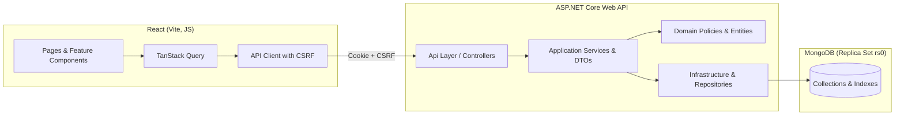

# Architecture Specification

## 1. Overview
EduCore is an India-focused college management system structured as a **modular monolith**. It pairs a React single-page application (plain JavaScript, Vite) with an ASP.NET Core Web API backend and MongoDB persistence.



---

## 2. Frontend Architecture
- **Language & Tooling:** JavaScript only (no TypeScript), bundled via Vite.
- **Server State Management:** **TanStack Query (v5)** manages all API data fetching, server caching, pagination, and invalidations.
- **Local Component State:** Standard React `useState` / `useReducer` for local UI state (modals, drawers, multi-step forms, tab selections).
- **Styling:** **Tailwind CSS** with design tokens defined in [`docs/design-system.md`](file:///d:/production/arise-craft/EduCore/docs/design-system.md) and **Lucide React** for accessible icons.
- **API Client:** Centralized HTTP client (`shared/api/client.js`) managing:
  - Base URL configuration.
  - Credential inclusion (`credentials: "include"`) for cookie transmission.
  - Extraction of the CSRF token cookie (`XSRF-TOKEN`) and forwarding as `X-XSRF-TOKEN` header on mutating requests.
  - Consistent error normalization from RFC 7807 `ProblemDetails`.

---

## 3. Backend Architecture & Clean Boundaries

EduCore backend is organized into 4 projects in `backend/EduCore.sln` plus 2 test projects:
1. `EduCore.Domain`: Pure domain entities, value objects, domain errors, enums, and testable domain policies (`AdmissionPolicy`, `FeePolicy`, `AttendancePolicy`, `GradingPolicy`). Zero external dependencies.
2. `EduCore.Application`: Use cases / application services, Request/Response DTOs, FluentValidation validators, mapping profiles, and service interfaces (`ISequenceGeneratorService`, `IAuditService`).
3. `EduCore.Infrastructure`: MongoDB C# Driver integration, BSON document mappings, index configuration, transaction session management, sequence generator, and append-only audit repository.
4. `EduCore.Api`: Thin controllers, ASP.NET Core Cookie authentication, Antiforgery middleware, authorization policies, global exception handler (`ProblemDetails`), and OpenAPI/Swagger documentation.
5. `EduCore.UnitTests`: Unit tests for domain policies, validators, and service calculations.
6. `EduCore.IntegrationTests`: End-to-end API + MongoDB tests utilizing a real single-node replica set instance.

### Pragmatic Mapping Boundary
- To avoid excessive boilerplate while preserving encapsulation, DTOs are kept strictly separate from domain entities.
- Entities in `EduCore.Domain` represent business models. In `EduCore.Infrastructure`, MongoDB BSON conventions map entities cleanly to collections, representing ObjectIds as strings.
- Repositories return Domain Entities. Application services map Domain Entities to output DTOs. Controllers never interact directly with repositories or persistence documents.

---

## 4. MongoDB Consistency and Multi-Document Transactions

### 4.1 Single-Node Replica Set (`rs0`) Requirement
To guarantee financial ledger integrity and atomic admissions, EduCore mandates that development, testing, and production environments run MongoDB as a **single-node replica set** (or multi-node cluster), named `rs0`. This enables full multi-document ACID transactions via `IClientSession.StartTransaction()`.

### 4.2 Aggregate Consolidation vs. Transactions
1. **Single-Document Atomicity (Preferred):**
   - **Payment Allocations & Receipt:** Embedded in `payments` aggregate. Single-document insert records payment, receipt number, and allocations atomically.
   - **Attendance Registers:** Embedded in `classSessions.roster`. Single-document write updates the entire session's attendance.
2. **Multi-Document ACID Transactions (Required):**
   - Executed via an application transaction execution strategy:
     - **Payment Recording:** In 1 transaction: insert `payments` + update affected `feeObligations` (balances/status) + append `auditEvents`.
     - **Payment Reversal:** In 1 transaction: update `payments` to `REVERSED` + void allocations + revert `feeObligations` + append `auditEvents`.
     - **Admission Confirmation:** In 1 transaction: update `applications` to `CONFIRMED` + insert `students` + insert `users` (`PENDING_ACTIVATION`) + atomic counter increment.
3. **Transaction Failure and Retry Handling:**
   - The infrastructure transaction wrapper catches `MongoTransientTransactionException` and retries transient failures up to 3 times with exponential backoff.
   - If a non-transient error occurs or max retries are exceeded, the transaction is automatically aborted (`session.AbortTransactionAsync()`). No partial changes are persisted.

---

## 5. Concurrency Control and Idempotency

### 5.1 Optimistic Concurrency Control (OCC)
All mutable aggregate roots (`courseOfferings`, `classSessions`, `feeObligations`, `payments`, `results`, `students`) include an integer `version` field. Updates perform atomic conditional matching:
```csharp
var filter = Builders<T>.Filter.And(
    Builders<T>.Filter.Eq(x => x.Id, entity.Id),
    Builders<T>.Filter.Eq(x => x.Version, entity.Version)
);
var update = updateDefinition.Inc(x => x.Version, 1);
var result = await collection.UpdateOneAsync(filter, update);
if (result.ModifiedCount == 0)
    throw new ConcurrencyException("Record has been modified by another user.");
```
Concurrency exceptions are caught by the global API exception filter and mapped to **HTTP 409 Conflict**.

### 5.2 Idempotency Strategy
Mutating financial and critical administrative endpoints require an `X-Idempotency-Key` header:
- Application checks `idempotencyRecords` collection.
- If key exists and is completed, the saved response is returned immediately.
- If in progress, the request waits or returns `409 Conflict`.
- If new, the transaction executes and records the response in `idempotencyRecords` with a 24-hour TTL expiration.

---

## 6. Identifier Serialization Standard
- All MongoDB ObjectIds are serialized as 24-character hexadecimal `string` values in C# models, DTOs, and JSON responses.
- Human-readable identifiers (`AdmissionNumber`, `RollNumber`, `ReceiptNumber`) are generated atomically using MongoDB's `$inc` on the `counters` collection and protected by unique indexes (see [`ADR-003`](file:///d:/production/arise-craft/EduCore/docs/adr/ADR-003-identifier-generation-and-atomic-counters.md)).
