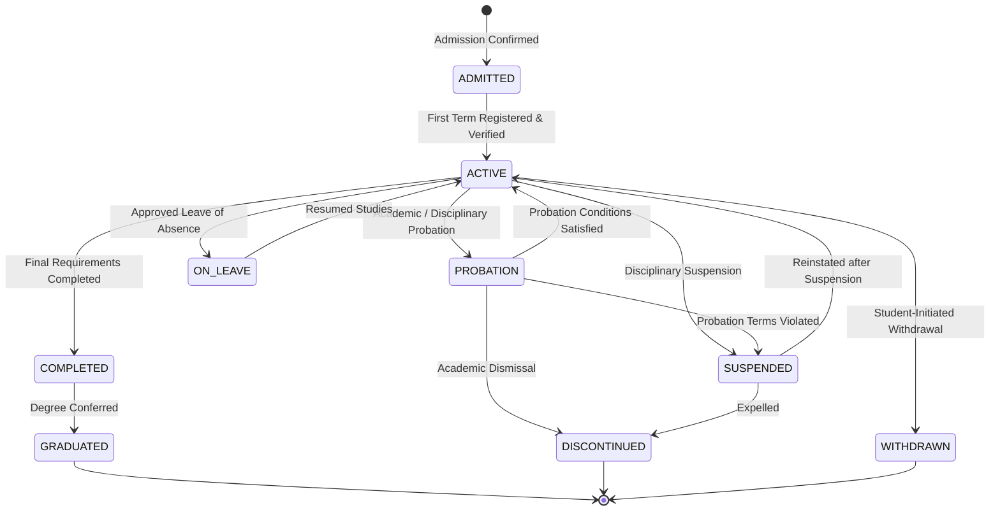

# Business Rules and Invariants

This document defines the core domain invariants, lifecycle states, state transitions, and business policies of EduCore. Exact institutional policy thresholds are configured in [`docs/policies/demo-institutional-policies.md`](file:///d:/production/arise-craft/EduCore/docs/policies/demo-institutional-policies.md).

---

## 1. Identity, Identifiers, and Student Lifecycle

### 1.1 Standardized Identifiers
EduCore distinguishes four distinct categories of identifiers:
1. `Id`: Internal MongoDB `ObjectId`, exposed strictly as a 24-character hexadecimal `string` in API DTOs.
2. `AdmissionNumber`: Official human-readable admission reference assigned upon admission confirmation (e.g., `ADM-2024-00042`). Generated via atomic counter; guaranteed unique per institution via a unique index on `students.admissionNumber`.
3. `RollNumber`: Institutional class/program roll number assigned at cohort registration (e.g., `24BCA-A015`). Format: `{YY}{PROGRAM_CODE}{SECTION}{000}`. Unique per program/admission year.
4. `UniversityRegNumber`: External university-issued registration number (e.g., `BC2400112`). Optional/nullable; unique when present via a sparse unique index on `students.universityRegNumber`.

### 1.2 Sequence Invariants and Failure Handling
- Sequential numbers are generated atomically from the `counters` collection using `$inc`.
- Numbers guarantee **uniqueness**, not strictly gapless series. If a transaction (e.g. admission confirmation) rolls back after incrementing a counter, the sequence value is discarded to preserve system throughput. Gaps in sequences are acceptable; duplicate numbers are strictly prevented by database indexes.

### 1.3 Student Lifecycle States (`StudentLifecycleStatus`)
The canonical student record (`students`) transitions through explicit lifecycle states:



- `ADMITTED`: Admission is confirmed; student profile created; pending initial term registration.
- `ACTIVE`: Fully enrolled student in good standing.
- `PROBATION`: Student failed minimum academic standing or attendance criteria but is conditionally permitted to continue.
- `ON_LEAVE`: Formal academic leave approved (medical, personal); enrollment paused.
- `SUSPENDED`: Disciplinary suspension; all academic actions blocked.
- `WITHDRAWN`: Voluntarily discontinued studies.
- `DISCONTINUED`: Institutionally dismissed/expelled for academic failure or misconduct.
- `COMPLETED`: Satisfied all program course and credit requirements; awaiting degree conferral.
- `GRADUATED`: Official degree conferred; alumnus record.

### 1.4 Invariants and Permissions
- Only `COLLEGE_ADMIN` or `ACADEMIC_ADMIN` can transition a student to `PROBATION`, `SUSPENDED`, or `DISCONTINUED`.
- Course enrollment, class attendance marking, and exam registration are permitted **only** when `lifecycleStatus` is `ACTIVE` or `PROBATION`.
- Student records with financial, academic, or attendance history are **never** hard-deleted.

---

## 2. Core Workflow Prerequisites

### 2.1 Admission Confirmation Prerequisites
- Application status must be `APPROVED`.
- Required identity and education documents must be marked `VERIFIED`.
- Program eligibility requirements must be evaluated and recorded.
- **Decoupling Rule:** In V1, admission confirmation does **not** require fee payment. Confirming admission moves application to `CONFIRMED`, creates the `Student` record in `ADMITTED` status, and generates the `AdmissionNumber`.

### 2.2 Student Account Activation Prerequisites
- Student must possess an official `AdmissionNumber`.
- Account status in `users` must be `PENDING_ACTIVATION`.
- Activation request must supply a valid, unexpired activation token (72-hour lifetime).
- Student must set a new password complying with security policies. Upon completion, status moves to `ACTIVE`.

### 2.3 Term Registration Prerequisites
- Student `lifecycleStatus` must be `ADMITTED` (for semester 1) or `ACTIVE` / `PROBATION` (for subsequent terms).
- Term registration window for the target `termId` must be `OPEN`.
- Student must not have an active disciplinary `SUSPENDED` flag.
- Student must not already possess a `termRegistration` record for that specific `termId` (one per student per term).

### 2.4 Examination Eligibility Prerequisites
For every assessment event in a term:
- Student must have an active `courseEnrollment` in the offering.
- Minimum attendance percentage must be $\ge 75.00\%$, or between $65.00\%$ and $74.99\%$ with an authorized, recorded condonation.
- Financial dues for the term must be cleared, or an explicit fee clearance exemption must be granted by `ACCOUNTS_OFFICER`.
- Candidate eligibility is frozen in `examRegistrations` prior to hall-ticket generation.

---

## 3. Academic Structure and Course Enrollment

### 3.1 Hierarchy and Curriculum Mapping
- An `Institution` contains `Departments` and `Programs`.
- A `Program` (e.g. BCA) defines an explicit `curriculum` mapping courses to specific semester numbers, credits, and core/elective status.
- An `AcademicYear` contains one or more `Terms` (e.g. Odd Semester 2024–2025).
- A `CourseOffering` is an instance of a `Course` offered in a specific `Term` and section, with assigned faculty and a maximum capacity.

### 3.2 Atomic Section Capacity Enforcement
- `courseOfferings` contains `capacity` and `enrolledCount`.
- Course enrollment must enforce capacity using atomic conditional updates:
  ```csharp
  var filter = Builders<CourseOffering>.Filter.And(
      Builders<CourseOffering>.Filter.Eq(x => x.Id, offeringId),
      Builders<CourseOffering>.Filter.Where(x => x.EnrolledCount < x.Capacity)
  );
  var update = Builders<CourseOffering>.Update.Inc(x => x.EnrolledCount, 1);
  var result = await collection.UpdateOneAsync(filter, update);
  if (result.ModifiedCount == 0) throw new CapacityExceededException();
  ```
- If subsequent enrollment persistence fails, the application compensates by atomically decrementing `enrolledCount`.

---

## 4. Attendance Rules

1. Attendance is recorded for a scheduled `classSession` and enrolled students.
2. The session attendance register is embedded directly in `classSessions` (`roster: [{ studentId, status, remarks, recordedAt }]`), ensuring single-document atomic register submission.
3. Valid status values: `PRESENT` (1.0), `ABSENT` (0.0), `LATE` (0.5), `EXCUSED` (excluded from denominator).
4. Register Lifecycle:
   `SCHEDULED` -> `IN_PROGRESS` -> `SUBMITTED` (locked for normal faculty entry) -> `CLOSED`.
5. Corrections:
   Once submitted, modifications require an audited correction workflow specifying `priorStatus`, `newStatus`, `reason`, `correctedBy`, and `authorizedBy`. Original audit records are never overwritten.

---

## 5. Fees and Financial Workflows

1. **Integer Paise:** All financial amounts are denominated in INR and stored as integer paise ($₹1 = 100 \text{ paise}$).
2. **Obligation vs. Payment:** An obligation is a liability; a payment is an asset transaction.
3. **Allocation Strategy:** Default allocation follows strict FIFO by `dueDate`. If due dates match, tie-breaker order is: `TUITION` -> `LAB` -> `LIBRARY` -> `EXAM` -> `MISC`. Authorized staff may override allocations manually with a documented reason.
4. **Overpayment Rejection (V1):** Payments exceeding the student's total unpaid obligations are rejected at the API boundary with `EXCESS_PAYMENT_NOT_PERMITTED`.
5. **Payment Atomicity:** Recording a payment requires a MongoDB transaction spanning `payments` (with embedded allocations and receipt metadata) and updating linked `feeObligations`.
6. **Reversal Invariant:** Reversals require a MongoDB transaction. The payment status changes to `REVERSED`; allocations are marked `VOID`; receipt is marked `CANCELLED`; affected `feeObligations` have `paidAmountPaise` decremented and status reverted; and an audit event is appended.
7. **Idempotency:** Payment submission requires an `X-Idempotency-Key` header to prevent duplicate processing on retries.

---

## 6. Examinations, Marks, and Results

### 6.1 Marks State Machine
Marks for each assessment follow an explicit state progression:
$$\text{DRAFT} \longrightarrow \text{SUBMITTED} \longrightarrow \text{MODERATED} \longrightarrow \text{LOCKED} \longrightarrow \text{APPROVED} \longrightarrow \text{PUBLISHED}$$

- `DRAFT`: Faculty enters/edits marks in a tabular batch grid.
- `SUBMITTED`: Faculty locks the marks register and submits to the Examination Cell.
- `MODERATED`: Exam Officer reviews marks. If adjustments are made, **both** `rawMarks` and `moderatedMarks` are preserved, accompanied by a required moderation reason.
- `LOCKED`: Marks entry window closed.
- `APPROVED`: Academic Dean / Controller of Examinations formally signs off.
- `PUBLISHED`: Result becomes visible to the student in the Student Portal.

### 6.2 Result Immutability and Amendments
- Published results are **immutable**. They cannot be directly edited or replaced.
- Any correction to a published result must occur via a formal `resultAmendments` record:
  `{ resultId, assessmentId, studentId, priorGrade, newGrade, priorMarks, newMarks, reason, requestedBy, approvedBy, timestamp }`.
- The amendment updates the current published result document under optimistic concurrency and appends an immutable audit log.

---

## 7. Optimistic Concurrency Control

All mutable aggregate roots must include an integer `version` property:
- `courseOfferings`
- `classSessions`
- `feeObligations`
- `payments`
- `results`
- `students`

Updates must condition on `{ _id: id, version: currentVersion }` and atomically increment `version` by 1. If 0 documents are modified, the operation throws a `ConcurrencyException`, which maps to HTTP `409 Conflict`, prompting the client to reload and reapply changes.
