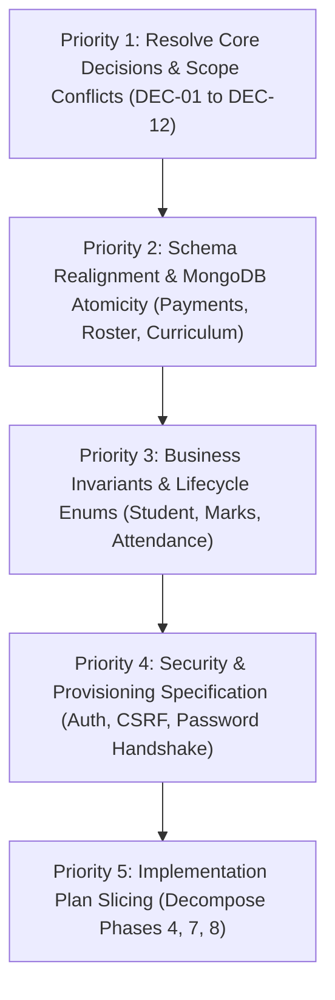

# EduCore — Phase 0: Project Bible Audit Report

**Document Version:** 1.0.0  
**Audit Date:** 2026-10-16  
**Auditor:** Antigravity (AI Architecture & Code Review)  
**Target Project:** EduCore — Student & Academic Management Platform  
**Target Repository:** `d:\production\arise-craft\EduCore`  
**Status:** Complete — Awaiting Approval  

---

## 1. Executive Summary

A comprehensive architectural and domain audit of the EduCore specification was conducted across all documentation in `docs/`, `AGENTS.md`, and `README.md`. The EduCore project is conceived as a modular monolith pairing a React (JavaScript + Vite) frontend with an ASP.NET Core Web API backend and MongoDB persistence, tailored for an Indian higher-education institution (demo institution: *Vidyadeep Institute of Technology, Bengaluru*).

### High-Level Assessment
The documentation provides a strong conceptual foundation with disciplined architectural principles: strict backend authority over business logic, separation of concerns, UTC timestamps, integer paise financial arithmetic, and a phased vertical-slice delivery model.

However, the audit revealed several **critical domain contradictions**, **data model ambiguities**, **missing business invariants**, and **unresolved technical decisions** that must be reconciled before implementation begins. Most notably:
1. **Relational Over-Normalization vs. MongoDB Atomicity:** The conceptual schema decomposes aggregates into relational tables (`payments`, `paymentAllocations`, `receipts`; `classSessions`, `attendanceEntries`) despite `AGENTS.md` explicitly cautioning against assuming multi-document transaction availability.
2. **Student Lifecycle and Identity Gaps:** Fundamental lifecycle states (`StudentLifecycleStatus`) and human-readable identifier generation mechanisms are unspecified.
3. **Missing Curriculum and Academic Structure Entity:** The schema defines `courses` and `terms`, but lacks the relational bridge defining which courses belong to which program curriculum and semester.
4. **Scope & Permission Contradictions:** Premature student self-service application features contradict the staff-only admission boundary established for V1.
5. **Phase Granularity:** The implementation plan bundles complex multi-entity subsystems into single monolithic phases, violating the single vertical feature mandate.

**Readiness Verdict:** **READY AFTER CORRECTIONS**. The architecture is sound in vision, but the specification requires targeted clarifications and structural adjustments before foundation setup and code generation can safely begin.

---

## 2. Critical Contradictions and Risks

### Finding C-01: Contradiction in Application Submission and Student Self-Service Boundary
- **Affected Files:**
  - [`docs/open-decisions.md`](file:///d:/production/arise-craft/EduCore/docs/open-decisions.md#L8)
  - [`docs/roles-and-permissions.md`](file:///d:/production/arise-craft/EduCore/docs/roles-and-permissions.md#L22)
  - [`docs/workflows/admissions.md`](file:///d:/production/arise-craft/EduCore/docs/workflows/admissions.md#L4)
  - [`docs/SCOPE.md`](file:///d:/production/arise-craft/EduCore/docs/SCOPE.md#L11-L12)
- **Reason It Matters:**
  `docs/open-decisions.md` recommends that admission applications in V1 are entered strictly by staff. However, `docs/roles-and-permissions.md` specifies that the `STUDENT` role can view/submit "Own application, if enabled", and `docs/workflows/admissions.md` lists `Applicant` as an actor. Furthermore, an applicant is not yet an enrolled student, meaning granting `STUDENT` role access to an application creates an identity chicken-and-egg paradox.
- **Proposed Resolution:**
  Enforce the V1 boundary consistently across all documents: In V1, applications are solely entered, reviewed, and confirmed by `ADMISSIONS_OFFICER` and `COLLEGE_ADMIN`. Remove `Own application` from the `STUDENT` permission matrix for V1. Public applicant registration and self-service application tracking should be explicitly documented as deferred to V2.

---

### Finding C-02: Circular Dependency Between Admission Confirmation and Fee Collection
- **Affected Files:**
  - [`docs/implementation-plan.md`](file:///d:/production/arise-craft/EduCore/docs/implementation-plan.md#L36-L42)
  - [`docs/implementation-plan.md`](file:///d:/production/arise-craft/EduCore/docs/implementation-plan.md#L57-L62)
  - [`docs/workflows/admissions.md`](file:///d:/production/arise-craft/EduCore/docs/workflows/admissions.md#L12)
  - [`docs/workflows/fees-and-payments.md`](file:///d:/production/arise-craft/EduCore/docs/workflows/fees-and-payments.md#L5-L10)
- **Reason It Matters:**
  `docs/workflows/admissions.md` states: *"If approved and the applicant accepts/fulfils required conditions, staff confirms admission"*, which in Indian colleges universally includes payment of an admission/seat-blocking fee. However, Phase 4 implements Admissions and Student Records, while Fees and Payments is not implemented until Phase 7. If Phase 4 assumes fee payment is a prerequisite for admission confirmation, Phase 4 cannot be tested or demonstrated end-to-end.
- **Proposed Resolution:**
  Explicitly decouple admission confirmation from financial transaction processing in Phase 4. Document that confirming admission moves an application to `CONFIRMED` and creates the `Student` record in `ADMITTED` status. In Phase 7, fee obligations (including admission and term fees) are assessed. Academic registration and enrollment in Phase 5 may proceed under an `ADMITTED` or `ACTIVE` lifecycle status, with fee default rules enforced later at exam hall-ticket generation.

---

### Finding C-03: Identifier Terminology Confusion (`student number` vs. `institutional roll number`)
- **Affected Files:**
  - [`docs/business-rules.md`](file:///d:/production/arise-craft/EduCore/docs/business-rules.md#L9)
  - [`docs/database-schema.md`](file:///d:/production/arise-craft/EduCore/docs/database-schema.md#L20)
  - [`docs/indexes.md`](file:///d:/production/arise-craft/EduCore/docs/indexes.md#L10-L11)
- **Reason It Matters:**
  `docs/business-rules.md` mandates that *"Admission number, institutional roll number, and external university registration number are distinct fields"*. Yet `docs/database-schema.md` defines `students` with `student number, admission number, optional university registration number`. It is unclear whether `student number` is the internal surrogate key, the roll number, or a separate institutional registration identifier.
- **Proposed Resolution:**
  Standardize identifier definitions and naming across all documents:
  1. `Id`: MongoDB internal identifier (`ObjectId` represented as string).
  2. `AdmissionNumber`: Generated upon admission confirmation (e.g., `ADM-2024-0042`), unique per institution.
  3. `RollNumber`: Institutional class/program roll number assigned upon term/cohort registration (e.g., `24BCA015`), unique within program/admission year.
  4. `UniversityRegNumber`: External university-issued registration number (e.g., `BC2400112`), nullable/optional, unique when present.

---

### Finding C-04: Relational Decomposition vs. MongoDB Single-Document Consistency Risk
- **Affected Files:**
  - [`AGENTS.md`](file:///d:/production/arise-craft/EduCore/AGENTS.md#L43-L45)
  - [`docs/architecture.md`](file:///d:/production/arise-craft/EduCore/docs/architecture.md#L50-L54)
  - [`docs/database-schema.md`](file:///d:/production/arise-craft/EduCore/docs/database-schema.md#L25-L42)
- **Reason It Matters:**
  `AGENTS.md` explicitly warns: *"Do not claim multi-document atomicity unless the MongoDB deployment and transaction configuration support it. MongoDB multi-document transactions require an appropriate replica-set/sharded deployment. Keep embedded data bounded."* Despite this, `docs/database-schema.md` splits atomic transactional concepts across separate normalized collections:
  - `payments` + `paymentAllocations` + `receipts` (3 collections for a single payment event)
  - `classSessions` + `attendanceEntries` (individual attendance rows per student)
  - `assessments` + `marks` + `results` + `resultAmendments`
  If running on a standalone MongoDB instance (common for local dev, testing, or basic demo environments), inserting a payment without its allocations or receipt due to an unexpected failure produces financial ledger corruption.
- **Proposed Resolution:**
  Consolidate tightly-coupled bounded aggregates:
  1. **Payments Aggregate:** Embed `allocations` as a subdocument array inside `payments` (`allocations: [{ obligationId, amountPaise }]`). The number of obligations covered by a single payment is strictly bounded (typically 1 to 5). Embed receipt metadata (`receiptNumber`, `issuedAt`, `status`) directly on the `payments` document, removing the need for separate `paymentAllocations` and `receipts` collections.
  2. **Class Session Attendance:** A class section has a bounded capacity (30 to 70 students). Storing attendance entries inside `classSessions` (`roster: [{ studentId, status, remarks, recordedAt }]`) enables single-document atomic register submission, avoiding 60 individual document writes and race conditions during marking.

---

### Finding C-05: Undecided Candidate Eligibility Schema Representation
- **Affected Files:**
  - [`docs/database-schema.md`](file:///d:/production/arise-craft/EduCore/docs/database-schema.md#L38)
  - [`docs/workflows/examinations-and-results.md`](file:///d:/production/arise-craft/EduCore/docs/workflows/examinations-and-results.md#L6-L7)
- **Reason It Matters:**
  `docs/database-schema.md` states: *"examRegistrations or eligibility snapshots: assessmentId, studentId, outcome, reason codes, evaluatedAt"*. Stating "or" in the primary database schema leaves a core data contract unresolved prior to Phase 8.
- **Proposed Resolution:**
  Resolve the entity unambiguously: Define `examRegistrations` as the canonical collection. Each document represents a candidate's registration and eligibility evaluation for a specific examination event: `{ examRegistrationId, assessmentId, studentId, termId, isEligible, attendancePercentage, feeCleared, condonationGranted, condonationReason, hallTicketIssued, evaluatedAt }`.

---

## 3. Missing Business Rules and Workflows

### Finding M-01: Undefined Student Lifecycle States and Transitions
- **Affected Files:**
  - [`docs/business-rules.md`](file:///d:/production/arise-craft/EduCore/docs/business-rules.md#L5-L13)
  - [`docs/database-schema.md`](file:///d:/production/arise-craft/EduCore/docs/database-schema.md#L20)
  - [`docs/workflows/admissions.md`](file:///d:/production/arise-craft/EduCore/docs/workflows/admissions.md#L18-L19)
- **Reason It Matters:**
  `docs/database-schema.md` mentions `lifecycle status` on the `students` document, but nowhere in `docs/` is the enumeration of valid lifecycle states or their permitted state transitions defined. Without this, services cannot validate state changes (e.g., whether a suspended student can enroll in courses or pay fees).
- **Proposed Resolution:**
  Define the official `StudentLifecycleStatus` enum and transition matrix in `docs/business-rules.md`:
  - Valid States: `ADMITTED`, `ACTIVE`, `PROBATION`, `SUSPENDED`, `ON_LEAVE`, `WITHDRAWN`, `DISCONTINUED`, `COMPLETED`, `GRADUATED`.
  - Permitted Transitions:
    - `ADMITTED` -> `ACTIVE` (upon term registration and verification)
    - `ACTIVE` -> `PROBATION` | `ON_LEAVE` | `SUSPENDED` | `WITHDRAWN` | `COMPLETED`
    - `PROBATION` -> `ACTIVE` | `SUSPENDED` | `DISCONTINUED`
    - `ON_LEAVE` -> `ACTIVE` | `DISCONTINUED`
    - `SUSPENDED` -> `ACTIVE` | `DISCONTINUED`
    - `COMPLETED` -> `GRADUATED`
  - Invariants: Course enrollment and attendance marking are permitted only when status is `ACTIVE` or `PROBATION`.

---

### Finding M-02: Missing Program Curriculum / Term-Course Association Model
- **Affected Files:**
  - [`docs/database-schema.md`](file:///d:/production/arise-craft/EduCore/docs/database-schema.md#L10-L15)
  - [`docs/workflows/student-enrollment.md`](file:///d:/production/arise-craft/EduCore/docs/workflows/student-enrollment.md#L6-L12)
- **Reason It Matters:**
  `database-schema.md` defines `programs` and `courses` (where courses only reference `institutionId`). There is no data structure defining which courses belong to a program's curriculum, which semester they are taught in, whether they are core or elective, or how many credits they carry in that program. Without a curriculum structure, the academic administrator cannot know which courses to offer for a term, and the system cannot validate prerequisite or compulsory course requirements.
- **Proposed Resolution:**
  Add a `programCurricula` collection or embed a structured `curriculum` array within `programs`:
  ```json
  "curriculum": [
    {
      "semesterNumber": 1,
      "courseId": "ObjectId",
      "courseCode": "BCA101",
      "title": "Programming in C",
      "credits": 4,
      "isElective": false,
      "electiveGroup": null
    }
  ]
  ```

---

### Finding M-03: Missing Term Structure & Student Cohort Representation
- **Affected Files:**
  - [`docs/database-schema.md`](file:///d:/production/arise-craft/EduCore/docs/database-schema.md#L12,L21)
  - [`docs/workflows/student-enrollment.md`](file:///d:/production/arise-craft/EduCore/docs/workflows/student-enrollment.md#L6-L10)
- **Reason It Matters:**
  In `database-schema.md`, `terms` contains institution-level temporal periods (e.g., "Odd Semester 2024-2025"), while `termRegistrations` records `studentId, termId, status, registration date`. However, `termRegistrations` does not record what academic program year or semester stage the student is currently enrolled in (e.g., BCA Semester 3). Without this, academic progression cannot track movement from Semester 1 to Semester 2.
- **Proposed Resolution:**
  Update `termRegistrations` in `docs/database-schema.md` to:
  `{ studentId, termId, programId, semesterNumber, academicStanding, status, registeredAt }`.

---

### Finding M-04: Undefined Attendance Calculation Rules and Status Weighting
- **Affected Files:**
  - [`docs/business-rules.md`](file:///d:/production/arise-craft/EduCore/docs/business-rules.md#L28-L29)
  - [`docs/workflows/attendance.md`](file:///d:/production/arise-craft/EduCore/docs/workflows/attendance.md#L18)
  - [`docs/open-decisions.md`](file:///d:/production/arise-craft/EduCore/docs/open-decisions.md#L11)
- **Reason It Matters:**
  `docs/workflows/attendance.md` states: *"Percentage calculations must define treatment of cancelled sessions, approved leave, late attendance and excused absence"*, but no default demo rules or mathematical formulas are given. If attendance calculation is left to developer interpretation, the resulting exam eligibility checks will be unpredictable.
- **Proposed Resolution:**
  Document the standard demo attendance policy in `docs/business-rules.md`:
  - Attendance Statuses: `PRESENT`, `ABSENT`, `LATE`, `EXCUSED`.
  - Formulas:
    - Total Valid Sessions = `Total Conducted Sessions - Excused Sessions`
    - Attended Sessions = `Count(PRESENT) + (0.5 * Count(LATE))`
    - Attendance Percentage = `(Attended Sessions / Total Valid Sessions) * 100` (rounded to 2 decimal places).
  - Cancelled sessions are marked `CANCELLED` and excluded from both numerator and denominator.
  - Threshold for Exam Eligibility: 75.0%. Condonation permitted between 65.0% and 74.9% with recorded Dean/Principal approval.

---

### Finding M-05: Missing Fee Allocation Strategy and Overpayment Business Rules
- **Affected Files:**
  - [`docs/open-decisions.md`](file:///d:/production/arise-craft/EduCore/docs/open-decisions.md#L18-L20)
  - [`docs/business-rules.md`](file:///d:/production/arise-craft/EduCore/docs/business-rules.md#L35-L40)
  - [`docs/workflows/fees-and-payments.md`](file:///d:/production/arise-craft/EduCore/docs/workflows/fees-and-payments.md#L8-L20)
- **Reason It Matters:**
  When a student makes a partial payment against multiple fee obligations (e.g. Tuition + Lab + Library), the system must have a deterministic allocation priority. Furthermore, if a payment exceeds the total outstanding balance, how the excess is handled (whether rejected or held as credit) is listed as an open decision.
- **Proposed Resolution:**
  Establish the following V1 financial rules:
  1. **Allocation Priority:** Default allocation follows strict FIFO by obligation due date; for obligations with identical due dates, allocate in priority order: `TUITION` -> `LAB` -> `LIBRARY` -> `EXAM` -> `MISC`. Accounts staff can override allocation manually when recording payments.
  2. **Overpayment Rule:** Prohibit overpayments in V1. Payments exceeding the student's total unpaid obligations are rejected with a validation error (`EXCESS_PAYMENT_NOT_PERMITTED`). This eliminates the requirement for complex student credit balances or deposit accounts in V1.

---

### Finding M-06: Undefined Payment Reversal and Concession Workflow Mechanics
- **Affected Files:**
  - [`docs/workflows/fees-and-payments.md`](file:///d:/production/arise-craft/EduCore/docs/workflows/fees-and-payments.md#L16-L18)
  - [`docs/database-schema.md`](file:///d:/production/arise-craft/EduCore/docs/database-schema.md#L33)
- **Reason It Matters:**
  When a payment is reversed due to a bounced cheque or erroneous entry, the document mentions an "authorized reversal workflow", but fails to specify the exact state changes and financial invariants that must occur.
- **Proposed Resolution:**
  Document explicit reversal invariants in `docs/workflows/fees-and-payments.md`:
  - Payments are append-only; recorded payments are never deleted.
  - Reversal updates `payments.status` to `REVERSED` and appends `reversalDetails: { reversedBy, reversedAt, reason, authorizedBy }`.
  - The payment's allocations are marked `VOID`.
  - Linked receipt status updates to `CANCELLED`.
  - Affected `feeObligations` have their `paidAmountPaise` reduced by the reversed allocation amount, and their status automatically reverts from `PAID` to `PARTIALLY_PAID` or `PENDING`.
  - A financial audit event is recorded.

---

### Finding M-07: Marks Entry, Moderation, and Publication Lifecycle Missing Explicit States
- **Affected Files:**
  - [`docs/workflows/examinations-and-results.md`](file:///d:/production/arise-craft/EduCore/docs/workflows/examinations-and-results.md#L8-L11)
  - [`docs/roles-and-permissions.md`](file:///d:/production/arise-craft/EduCore/docs/roles-and-permissions.md#L29-L30)
- **Reason It Matters:**
  The relationship between raw marks entered by faculty and final approved/published term results is vague. `roles-and-permissions.md` states Exam Officers have "Oversight" of marks entry, while `screens.md` refers to a "moderation queue". It is not clear whether moderation allows altering faculty marks directly or adjusting scaling curves.
- **Proposed Resolution:**
  Define the marks and results lifecycle clearly:
  1. `AssessmentMarksStatus`: `DRAFT` (faculty editing) -> `SUBMITTED` (locked by faculty) -> `MODERATED` (reviewed by Exam Officer) -> `LOCKED`.
  2. Moderation rules: If marks are adjusted during moderation, the original raw mark is preserved, the adjusted mark is recorded, and a reason must be supplied.
  3. `ResultPublicationStatus`: `DRAFT_COMPILED` -> `PENDING_APPROVAL` -> `APPROVED` -> `PUBLISHED`.
  4. Only published results are visible to students. Published results are immutable; corrections require an explicit `ResultAmendment` with prior values, new values, approval, and audit logging.

---

### Finding M-08: Sequential Identifier Generation Strategy in MongoDB
- **Affected Files:**
  - [`docs/business-rules.md`](file:///d:/production/arise-craft/EduCore/docs/business-rules.md#L9-L10)
  - [`docs/database-schema.md`](file:///d:/production/arise-craft/EduCore/docs/database-schema.md)
  - [`docs/indexes.md`](file:///d:/production/arise-craft/EduCore/docs/indexes.md#L10-L12,L18)
- **Reason It Matters:**
  Unique human-readable numbers (`applicationNumber`, `admissionNumber`, `rollNumber`, `receiptNumber`) are required to be unique and sequential. In a multi-user web application, relying on client-supplied counts or `collection.CountDocumentsAsync() + 1` causes race conditions, duplicate IDs, and unique index constraint violations under concurrent requests.
- **Proposed Resolution:**
  Add a dedicated `counters` collection to `docs/database-schema.md`:
  `{ _id: "sequence_name", sequenceValue: 10001 }`.
  Implement an atomic sequence generator service using MongoDB's `FindOneAndUpdateAsync` with `$inc` to guarantee gapless, collision-free numbers even under high concurrency.

---

## 4. MongoDB and Architecture Concerns

### Finding A-01: Absence of Optimistic Concurrency Control Across High-Conflict Documents
- **Affected Files:**
  - [`AGENTS.md`](file:///d:/production/arise-craft/EduCore/AGENTS.md#L44)
  - [`docs/architecture.md`](file:///d:/production/arise-craft/EduCore/docs/architecture.md#L54)
  - [`docs/database-schema.md`](file:///d:/production/arise-craft/EduCore/docs/database-schema.md)
- **Reason It Matters:**
  `AGENTS.md` mandates: *"Use optimistic concurrency or another documented strategy where simultaneous updates could conflict."* However, none of the proposed document schemas in `database-schema.md` specify a `version` or `concurrencyToken` property. Critical operations such as course offering seat capacity, attendance corrections, payment recordings, and result amendments are susceptible to lost updates if two staff members submit edits concurrently.
- **Proposed Resolution:**
  Add an integer `version` field to all mutable aggregate roots: `courseOfferings`, `classSessions`, `feeObligations`, `payments`, `results`, and `students`. Enforce optimistic concurrency in repository update operations using conditional matching: `Builders<T>.Filter.And(Builders<T>.Filter.Eq(x => x.Id, entity.Id), Builders<T>.Filter.Eq(x => x.Version, entity.Version))`, incrementing `version` on every write and throwing a `ConcurrencyException` (mapped to HTTP `409 Conflict`) if zero documents are matched.

---

### Finding A-02: Race Condition on Course Offering Capacity Enforcement
- **Affected Files:**
  - [`docs/database-schema.md`](file:///d:/production/arise-craft/EduCore/docs/database-schema.md#L14)
  - [`docs/workflows/student-enrollment.md`](file:///d:/production/arise-craft/EduCore/docs/workflows/student-enrollment.md#L15,L24)
- **Reason It Matters:**
  `docs/workflows/student-enrollment.md` acceptance tests require: *"Capacity is not exceeded under concurrent enrollment"*. If `courseOfferings` merely stores `capacity`, and the application checks seat availability by querying `courseEnrollments.CountAsync() < capacity`, concurrent requests can oversubscribe the class offering before new enrollment records are saved.
- **Proposed Resolution:**
  Denormalize `enrolledCount` on the `courseOfferings` document. During course enrollment, perform an atomic conditional decrement/increment:
  ```csharp
  var filter = Builders<CourseOffering>.Filter.And(
      Builders<CourseOffering>.Filter.Eq(x => x.Id, offeringId),
      Builders<CourseOffering>.Filter.Where(x => x.EnrolledCount < x.Capacity)
  );
  var update = Builders<CourseOffering>.Update.Inc(x => x.EnrolledCount, 1);
  var result = await collection.UpdateOneAsync(filter, update);
  if (result.ModifiedCount == 0) throw new CapacityExceededException();
  ```
  If subsequent enrollment persistence fails, compensate by atomically decrementing `enrolledCount`.

---

### Finding A-03: Domain Entity vs. Persistence Document vs. DTO Layering Clarity
- **Affected Files:**
  - [`AGENTS.md`](file:///d:/production/arise-craft/EduCore/AGENTS.md#L19-L20,L29)
  - [`docs/architecture.md`](file:///d:/production/arise-craft/EduCore/docs/architecture.md#L16-L23)
  - [`docs/policies/README.md`](file:///d:/production/arise-craft/EduCore/docs/policies/README.md#L19-L20)
- **Reason It Matters:**
  `AGENTS.md` correctly forbids exposing database documents in controllers and UI components. However, `docs/architecture.md` lists `Application Services`, `Policies`, `Repositories`, and `Persistence/Models` without clarifying whether domain entities and persistence models are separate C# classes or unified. If they are completely separate, excessive manual mapping between MongoDB BSON entities, Domain entities, and DTOs will create boilerplate; if unified, domain invariants risk being bypassed.
- **Proposed Resolution:**
  Formally define the mapping boundary:
  - `EduCore.Domain`: Pure Domain Entities encapsulating invariants and state transitions, along with pure Policy classes.
  - `EduCore.Infrastructure`: MongoDB documents that map directly to collections using C# MongoDB driver BSON attributes, or direct mapping where domain entities use clean BSON conventions without leaking persistence details.
  - `EduCore.Application`: Request and Response DTOs, FluentValidation validators, and application services that map Domain Entities <-> DTOs.

---

### Finding A-04: ID Serialization and Data Type Standard in .NET Web API
- **Affected Files:**
  - [`docs/open-decisions.md`](file:///d:/production/arise-craft/EduCore/docs/open-decisions.md#L27)
  - [`docs/database-schema.md`](file:///d:/production/arise-craft/EduCore/docs/database-schema.md#L50)
  - [`docs/api-contracts.md`](file:///d:/production/arise-craft/EduCore/docs/api-contracts.md#L7-L8)
- **Reason It Matters:**
  MongoDB's native `ObjectId` is a 12-byte BSON type. By default, ASP.NET Core System.Text.Json serializes `ObjectId` as a complex object (`{ timestamp, machine, pid, increment }`) rather than a 24-character hexadecimal string, causing serialization errors, broken frontend client contracts, and Swagger schema rendering bugs.
- **Proposed Resolution:**
  Standardize on string-based representations of ObjectIds across the application layer:
  - In Domain / Infrastructure models: Annotate IDs with `[BsonId] [BsonRepresentation(BsonType.ObjectId)] public string Id { get; set; } = string.Empty;`.
  - In DTOs: Represent all IDs strictly as standard JSON `string` values.
  - Configure the MongoDB driver conventions globally in `EduCore.Infrastructure` during Phase 1.

---

## 5. Security and Authorization Concerns

### Finding S-01: Undefined Authentication and Session Lifetime Strategy
- **Affected Files:**
  - [`docs/security-and-privacy.md`](file:///d:/production/arise-craft/EduCore/docs/security-and-privacy.md#L4-L7)
  - [`docs/open-decisions.md`](file:///d:/production/arise-craft/EduCore/docs/open-decisions.md#L25)
  - [`docs/api-contracts.md`](file:///d:/production/arise-craft/EduCore/docs/api-contracts.md#L24)
- **Reason It Matters:**
  `docs/security-and-privacy.md` instructs to: *"Define session/token lifetime, renewal, revocation and logout behavior before implementation"*. Leaving this open creates ambiguity in Phase 1 and Phase 2. If JWTs stored in browser `localStorage` are used, the application becomes vulnerable to Cross-Site Scripting (XSS) token theft.
- **Proposed Resolution:**
  Adopt standard **ASP.NET Core Cookie Authentication** for the single-origin web SPA:
  - Authentication via `POST /api/v1/auth/login`.
  - Secure, `HttpOnly`, `SameSite=Strict` session cookie with sliding expiration (60 minutes).
  - Anti-Forgery token validation (`ValidateAntiForgeryToken`) for state-changing HTTP requests (`POST`, `PUT`, `DELETE`).
  - Passwords hashed using ASP.NET Core `PasswordHasher<T>` (PBKDF2 with HMAC-SHA512).
  - This avoids token handling in JavaScript entirely and protects against XSS credential exfiltration.

---

### Finding S-02: Missing Student User Provisioning and Credential Handshake
- **Affected Files:**
  - [`docs/workflows/admissions.md`](file:///d:/production/arise-craft/EduCore/docs/workflows/admissions.md#L12-L14)
  - [`docs/security-and-privacy.md`](file:///d:/production/arise-craft/EduCore/docs/security-and-privacy.md#L4-L5)
  - [`docs/database-schema.md`](file:///d:/production/arise-craft/EduCore/docs/database-schema.md#L17,L20)
- **Reason It Matters:**
  When an admissions officer confirms admission, a `students` record is created. However, the specification does not explain how or when the student's corresponding `users` account is created, what their initial credentials are, or how they activate their account without storing plaintext passwords or sending unencrypted secrets.
- **Proposed Resolution:**
  Define the student onboarding security workflow:
  1. Upon admission confirmation, the system creates a `users` record linked to `studentId` with role `STUDENT` and status `PENDING_ACTIVATION`.
  2. The system generates an account activation token (or temporary one-time password with a 72-hour expiry) printed on the official admission acknowledgment slip or sent to the student's verified email.
  3. First login forces a password reset before granting access to student portal routes.

---

### Finding S-03: Immutable Audit Log Enforcement at Repository Level
- **Affected Files:**
  - [`docs/database-schema.md`](file:///d:/production/arise-craft/EduCore/docs/database-schema.md#L44)
  - [`docs/roles-and-permissions.md`](file:///d:/production/arise-craft/EduCore/docs/roles-and-permissions.md#L31)
  - [`docs/security-and-privacy.md`](file:///d:/production/arise-craft/EduCore/docs/security-and-privacy.md#L22-L26)
- **Reason It Matters:**
  `auditEvents` must be strictly tamper-proof. If generic CRUD repository interfaces are applied to `auditEvents`, endpoints could inadvertently expose update or delete methods, compromising compliance and auditability.
- **Proposed Resolution:**
  Implement a dedicated, restricted `IAuditEventRepository` that exposes only `InsertAsync` and `QueryAsync` methods. Explicitly omit update, replace, and delete operations from both the repository interface and the MongoDB collection configuration.

---

## 6. UI/UX and Role-Navigation Gaps

### Finding U-01: Multi-Role Context Switching and Navigation Clutter
- **Affected Files:**
  - [`docs/PRODUCT.md`](file:///d:/production/arise-craft/EduCore/docs/PRODUCT.md#L23)
  - [`docs/roles-and-permissions.md`](file:///d:/production/arise-craft/EduCore/docs/roles-and-permissions.md#L14)
  - [`docs/navigation.md`](file:///d:/production/arise-craft/EduCore/docs/navigation.md#L18)
- **Reason It Matters:**
  The specification emphasizes: *"A user can have multiple roles... A user with multiple roles sees the union of permitted navigation, with clear role context"*. If a user holds both `FACULTY` and `ACADEMIC_ADMIN` roles, presenting a combined sidebar with 20+ navigation links violates the core product principle: *"Less clutter; show the next useful action"*.
- **Proposed Resolution:**
  Include an active **Workspace Switcher** in the top navigation shell. When a user has multiple assigned roles, a dropdown allows switching between workspaces (e.g. "Faculty View" vs. "Academic Admin View"), contextualizing the sidebar to that role while retaining underlying permissions.

---

### Finding U-02: Missing Frontend Styling and UI Tooling Specification
- **Affected Files:**
  - [`docs/design-system.md`](file:///d:/production/arise-craft/EduCore/docs/design-system.md#L19-L28)
  - [`docs/repository-structure.md`](file:///d:/production/arise-craft/EduCore/docs/repository-structure.md#L29-L39)
- **Reason It Matters:**
  `docs/design-system.md` provides visual tokens (deep indigo/navy, teal, cool light gray) but does not declare the CSS architecture (Tailwind CSS, CSS Modules, or vanilla CSS). Foundation setup in Phase 1 cannot configure build scripts, linting, or token classes without an agreed CSS tool.
- **Proposed Resolution:**
  Specify **Tailwind CSS** as the standard CSS framework for the React frontend, configured with custom color tokens (`primary: deep-navy`, `accent: teal`) in `tailwind.config.js`, paired with **Lucide React** for lightweight, accessible icons.

---

### Finding U-03: UI Interaction Pattern for Batch Tabular Data Entry
- **Affected Files:**
  - [`docs/design-system.md`](file:///d:/production/arise-craft/EduCore/docs/design-system.md#L15,L34)
  - [`docs/screens.md`](file:///d:/production/arise-craft/EduCore/docs/screens.md#L42,L44,L52)
- **Reason It Matters:**
  Marking attendance and entering assessment marks require rapid tabular entry for 30–70 students per class. If each table row triggers isolated server queries or individual component state re-renders, the UI will suffer from input latency and poor user experience.
- **Proposed Resolution:**
  Document a specific **Batch Entry Pattern** in `docs/design-system.md`: Tabular data forms maintain local grid state in React, support keyboard navigation (Tab/Enter/Arrow keys), highlight modified/dirty cells, validate entries inline, and submit the entire register via a single atomic API call with an explicit confirmation dialog.

---

## 7. Decisions Requiring Approval, with Recommended Defaults

The following table summarizes all pending decisions from `docs/open-decisions.md` and this audit, along with recommended defaults for approval:

| Decision ID | Topic | Options Considered | Recommended Default | Rationale |
|---|---|---|---|---|
| **DEC-01** | Multi-Tenancy Scope | Single-Institution vs. Multi-Tenant SaaS | **Single-Institution for V1** | Meets V1 target without complex tenant isolation overhead. |
| **DEC-02** | Student Portal Inclusion | Launch with Staff vs. Deferred | **Included in V1 (Phases 9/10)** | Essential for showing end-to-end student lifecycle in demo. |
| **DEC-03** | Admission Intake Mode | Staff-Entered vs. Public Applicant Portal | **Staff-Entered Only for V1** | Eliminates public authentication, rate-limiting, and guest user complexity. |
| **DEC-04** | Attendance Minimum & Condonation | 75% vs. 80% vs. No threshold | **75% minimum; Condonation down to 65%** | Standard Indian university norm (UGC / AICTE). |
| **DEC-05** | Grading System & Scale | UGC 10-Point Scale vs. Percentage Only | **UGC 10-Point Choice Based Credit System (CBCS)** | Standard recognized grading scale across Indian colleges: O (10), A+ (9), A (8), B+ (7), B (6), C (5), P (4), F (0). |
| **DEC-06** | Assessment Weightings | 50/50 vs. 40/60 vs. 30/70 | **40% CIA (Internal) / 60% SEE (Semester End Exam)** | Realistic split; requires minimum 40% in SEE and 40% aggregate to pass. |
| **DEC-07** | Fee Allocation Order | Manual vs. FIFO by Due Date vs. Pro-Rata | **FIFO by Due Date; Priority: Tuition -> Lab -> Library -> Misc** | Predictable, auditable, and automated default with manual staff override option. |
| **DEC-08** | Overpayment Handling | Store as Student Credit vs. Reject | **Reject Overpayments in V1** | Prevents need for unallocated advance credit ledger management in V1. |
| **DEC-09** | Authentication Mechanism | JWT Bearer in Storage vs. HttpOnly Cookie | **ASP.NET Core Cookie Authentication (HttpOnly, SameSite=Strict)** | Protects against XSS token theft in browser; standard for single-domain React SPA. |
| **DEC-10** | Database Identifier Strategy | Native ObjectId vs. UUID / Application Strings | **String representation of MongoDB ObjectId** | Best of both worlds: BSON ObjectId indexing efficiency + clean JSON serialization. |
| **DEC-11** | Human-Readable Numbering | Dynamic Count vs. Dedicated Sequence Collection | **Dedicated `counters` collection with atomic `$inc`** | Prevents race conditions and duplicate admission/roll/receipt numbers under concurrency. |
| **DEC-12** | Frontend Styling Framework | Vanilla CSS vs. CSS Modules vs. Tailwind CSS | **Tailwind CSS with Custom Design Tokens** | Rapid UI development, strict token adherence, zero runtime CSS overhead. |

---

## 8. Documentation Changes Required

To align the specification with the audit resolutions, the following files require targeted modifications once approved:

1. **[`docs/open-decisions.md`](file:///d:/production/arise-craft/EduCore/docs/open-decisions.md):**
   - Record approved decisions DEC-01 through DEC-12.
2. **[`docs/business-rules.md`](file:///d:/production/arise-craft/EduCore/docs/business-rules.md):**
   - Add `StudentLifecycleStatus` enum and transition invariants.
   - Define demo attendance formulas (Present, Absent, Late = 0.5, Excused) and 75% eligibility rule.
   - Add UGC 10-point grading scale and 40/60 internal/external weighting rule.
   - Standardize identifier names: `AdmissionNumber`, `RollNumber`, `UniversityRegNumber`.
   - Specify FIFO fee allocation order and overpayment rejection invariant.
3. **[`docs/database-schema.md`](file:///d:/production/arise-craft/EduCore/docs/database-schema.md):**
   - Consolidate `payments`: embed `allocations: [{ obligationId, amountPaise }]` and receipt metadata, removing separate `paymentAllocations` and `receipts` collections.
   - Embed attendance roster inside `classSessions` (`roster: [{ studentId, status, remarks, recordedAt }]`) to enable single-document atomic marking.
   - Add `programCurricula` or embed `curriculum` inside `programs`.
   - Add `enrolledCount` and `version` to `courseOfferings`.
   - Add `version` (optimistic concurrency) to `students`, `feeObligations`, and `results`.
   - Add `counters` collection for sequential numbers.
4. **[`docs/roles-and-permissions.md`](file:///d:/production/arise-craft/EduCore/docs/roles-and-permissions.md):**
   - Remove `Own application` from the `STUDENT` column for V1.
   - Explicitly detail `ADMISSIONS_OFFICER` permissions for admission confirmation and student profile creation.
5. **[`docs/security-and-privacy.md`](file:///d:/production/arise-craft/EduCore/docs/security-and-privacy.md):**
   - Specify Cookie authentication (`HttpOnly`, `SameSite=Strict`), CSRF protection, and student account onboarding handshake.
6. **[`docs/design-system.md`](file:///d:/production/arise-craft/EduCore/docs/design-system.md):**
   - Specify Tailwind CSS and declare the batch tabular data entry pattern.
7. **[`docs/implementation-plan.md`](file:///d:/production/arise-craft/EduCore/docs/implementation-plan.md):**
   - Decompose monolithic phases (Phases 4, 7, and 8) into explicit micro-vertical tasks.

---

## 9. Prioritized List of Corrections

The following prioritized sequence should be executed before starting Phase 1 implementation:



### Priority 1: Resolve Core Decisions & Scope Conflicts (Immediate)
- Approve recommended defaults in Section 7.
- Reconcile `docs/open-decisions.md` and remove applicant self-service from V1 in `roles-and-permissions.md`.

### Priority 2: Schema Realignment & MongoDB Atomicity
- Update `docs/database-schema.md` to embed payment allocations, embed session rosters, add the curriculum bridge, and introduce optimistic concurrency `version` tokens.

### Priority 3: Business Invariants & Lifecycle Enums
- Update `docs/business-rules.md` with explicit enums for student lifecycle, attendance formulas, UGC 10-point grading scales, and identifier terminology.

### Priority 4: Security & Provisioning Specification
- Formalize ASP.NET Core cookie authentication, student user provisioning on admission confirmation, and append-only audit repository rules in `docs/security-and-privacy.md`.

### Priority 5: Implementation Plan Task Decomposition
- Restructure `docs/implementation-plan.md` to split Phases 4, 7, and 8 into smaller vertical increments, ensuring each step respects the single vertical slice rule.

---

## 10. Readiness Verdict

### **Verdict: READY AFTER CORRECTIONS**

**Justification:**  
The conceptual architecture and domain boundaries of EduCore are solid, maintainable, and well-aligned with the goals of a serious showcase project. However, the application specification is not yet ready for immediate code foundation because:
1. Writing database models now would create fragile, over-normalized MongoDB schemas that contradict the single-document atomicity guidance in `AGENTS.md`.
2. Core entity relationships (such as curriculum course assignments) and lifecycle states are missing.
3. Crucial architectural choices (Cookie vs. JWT auth, styling framework, sequential ID generation) are documented as unresolved open decisions.

**Next Step:**  
Review this audit report and approve the proposed resolutions and default decisions (Section 7). Upon approval, apply the documented corrections to `docs/`, after which the project will be declared **READY FOR FOUNDATION** (Phase 1).
