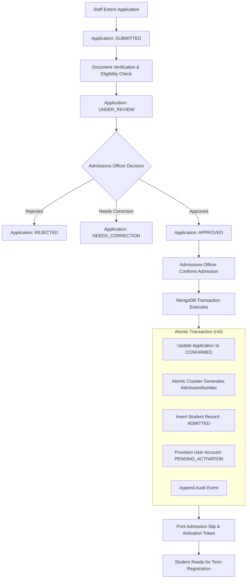

# Admissions Workflow Specification

## 1. Actors and Roles
- **Admissions Officer (`ADMISSIONS_OFFICER`):** Enters paper/walk-in applications, verifies document checklists, records eligibility outcomes, makes admission decisions, and confirms admissions.
- **College Administrator (`COLLEGE_ADMIN`):** System oversight, quota approvals, and emergency decision overrides.
- *(Public Applicant online self-service is explicitly deferred to V2).*

---

## 2. Main Path Workflow

### 2.1 Step-by-Step Execution
1. **Intake:** Admissions staff enters applicant details, previous academic qualification records, and program choices. The system atomically generates an application number (`APP-{YYYY}-{00000}`) and sets state to `SUBMITTED`.
2. **Verification:** Staff reviews original physical or digital certificates (Marks sheets, Transfer Certificate, Caste/Income certificates where applicable). Each document in `documentChecklist` is flagged `isVerified = true` with actor ID and UTC timestamp.
3. **Eligibility Check:** The server validates applicant percentages against the program's configured minimum eligibility threshold (e.g. 50% in 10+2 for BCA). State moves to `UNDER_REVIEW`.
4. **Decision:** An authorized Admissions Officer approves or rejects the application. If rejected or returned for correction, a structured reason is mandatory.
5. **Admission Confirmation (Decoupled from Payment):**
   - When an approved applicant accepts the offer, the officer executes "Confirm Admission".
   - **Crucial Rule:** In V1, admission confirmation does **not** require payment collection. Fee obligations are generated upon term registration, allowing student onboarding and academic setup to proceed independently.
6. **Atomic Provisioning Transaction:**
   A MongoDB multi-document transaction executes atomically:
   - Application state transitions to `CONFIRMED`.
   - Next sequential `AdmissionNumber` is generated via atomic `$inc` on the `counters` collection (`ADM-{YYYY}-{00000}`).
   - Canonical `Student` document is inserted in `lifecycleStatus: "ADMITTED"`.
   - Student `User` account is inserted with `roles: ["STUDENT"]`, `status: "PENDING_ACTIVATION"`, and a hashed activation token with a 72-hour expiration.
   - An immutable `AuditEvent` is written.
7. **Handoff:** The system prints the official Admission Confirmation Slip displaying the `AdmissionNumber` and one-time account activation token. The student is now available for term registration by the Academic Administrator.

---

## 3. Business Invariants and Error Handling

1. **Duplicate Prevention:**
   - Unique index on `students.applicationId` strictly prevents confirming the same application multiple times.
   - Unique index on `students.admissionNumber` prevents duplicate numbers.
   - Duplicate applicant detection flags potential matches (matching phone number or date of birth + last name) for manual staff review before submission.
2. **Transaction Rollback Handling:**
   - If any step in the confirmation transaction fails (e.g., duplicate index violation or database connectivity drop), the transaction aborts completely. No orphaned `Student` or `User` records are persisted.
3. **Immutability of Confirmed Applications:**
   - A `CONFIRMED` application cannot be reverted to `UNDER_REVIEW` or `DRAFT`. If a student withdraws, the student's lifecycle status transitions to `WITHDRAWN`, preserving full historical traceability.

---

## 4. Verification and Automated Testing Expectations

- **Unit Tests:** `AdmissionPolicy` verifies eligibility thresholds, invalid state transitions, and duplicate prevention rules.
- **Integration Tests:** Execute `ConfirmAdmission` against a MongoDB replica set:
  - Verify that `CONFIRMED` state, `Student` record, and `User` record are committed together.
  - Verify that injecting a failure halfway rolls back all entities cleanly.
  - Verify that a second confirmation request on the same application returns `409 Conflict`.
