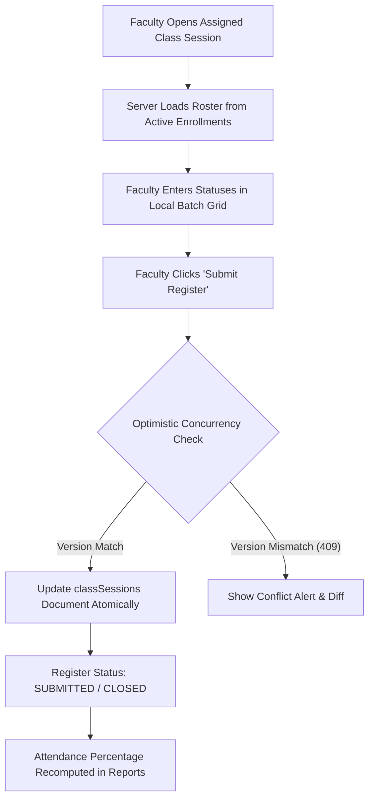

# Attendance Workflow Specification

## 1. Actors and Roles
- **Faculty (`FACULTY`):** Opens assigned class sessions, enters attendance registers using tabular batch mode, submits registers, and requests corrections.
- **Academic Administrator (`ACADEMIC_ADMIN`):** Oversight across all offerings, session cancellation, and approval of attendance corrections.
- **Student (`STUDENT`):** Views subject-wise attendance percentages and individual session status via the Student Portal.

---

## 2. Main Path Workflow

### 2.1 Step-by-Step Execution
1. **Session Opening:** Faculty selects a scheduled session from "My Classes". The server verifies that the faculty member is assigned to the course offering and that the session status is `SCHEDULED` or `IN_PROGRESS`.
2. **Roster Loading:** The system builds the session roster from active `courseEnrollments` for that offering.
3. **Tabular Batch Entry:**
   - Faculty marks statuses in the high-density grid using keyboard shortcuts (`P` = Present, `A` = Absent, `L` = Late, `E` = Excused).
   - Modifying a cell marks it with a dirty-cell indicator in local React state.
   - Inline validations ensure every student has an assigned status.
4. **Atomic Batch Submission:**
   - Faculty clicks "Submit Register".
   - The entire roster array is sent in a single `PUT /api/v1/attendance/sessions/{sessionId}/roster` call.
   - The server validates faculty ownership, checks the `version` field (OCC), updates `classSessions.roster`, sets `status = "SUBMITTED"`, and records `submittedAt` and `submittedBy`.
5. **Session Closure:** After a configured review period (e.g., 24 hours), sessions transition to `CLOSED`.

---

## 3. Audited Correction Workflow

1. Once a session register is in `SUBMITTED` or `CLOSED` status, faculty cannot overwrite cell values directly.
2. **Correction Request:** Faculty or Academic Admin submits an attendance correction request specifying:
   - `studentId`
   - `priorStatus`
   - `newStatus`
   - `reason` (mandatory, e.g., "Late arrival verified", "Medical certificate approved")
3. **Audit Immutability:**
   - The correction is appended to `classSessions.roster[i].corrections: [{ priorStatus, newStatus, reason, correctedBy, correctedAt, authorizedBy }]`.
   - The active status for the student is updated to `newStatus`.
   - The prior value is **never deleted or overwritten**, preserving a full forensic audit trail.
   - An entry is appended to `auditEvents`.

---

## 4. Attendance Percentage Calculation Rules

The attendance percentage for an enrolled student in a course offering is derived as defined in [`docs/policies/demo-institutional-policies.md`](file:///d:/production/arise-craft/EduCore/docs/policies/demo-institutional-policies.md):
- `PRESENT`: weight = 1.0.
- `LATE`: weight = 0.5 (within 15 min).
- `ABSENT`: weight = 0.0.
- `EXCUSED`: excluded from the denominator.
- `CANCELLED` sessions are excluded completely.

$$\text{Percentage} = \frac{\text{Count}(\text{PRESENT}) \times 1.0 + \text{Count}(\text{LATE}) \times 0.5}{\text{Total Conducted Sessions} - \text{Count}(\text{EXCUSED})} \times 100$$
Results are rounded to two decimal places using half-up rounding.

### Examination Eligibility Evaluation
- $\ge 75.00\%$: Eligible for examination hall-ticket.
- $65.00\% - 74.99\%$: Ineligible by default; eligible only if a formal condonation is recorded by `COLLEGE_ADMIN` in `examRegistrations`.
- $< 65.00\%$: Detained; ineligible for exam; must repeat the course offering.

---

## 5. Testing Requirements

- **Batch Atomic Persistence Test:** Submit attendance for 60 students in one call; verify that the session document is updated atomically.
- **Concurrency Test:** Simulate two faculty browsers submitting the same session register with differing versions; verify the second request receives HTTP `409 Conflict`.
- **Correction Audit Test:** Perform a correction on a student's status from `ABSENT` to `PRESENT`; verify that `roster[i].corrections` contains the original status, reason, and actor ID.
- **Percentage Formula Test:** Unit test percentage calculations against all status combinations, zero sessions, cancelled sessions, and boundary condonation thresholds.
