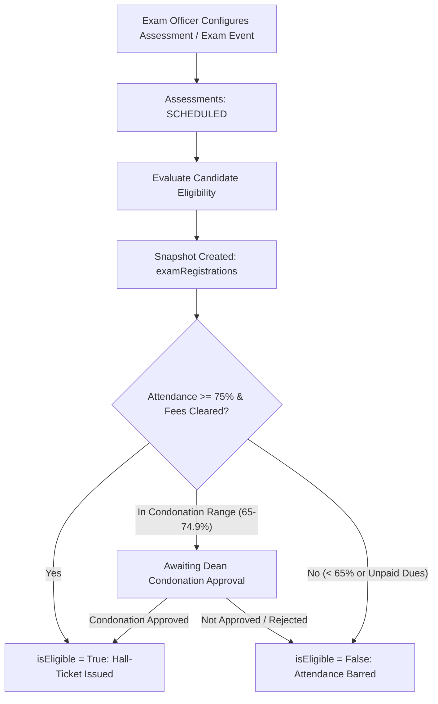
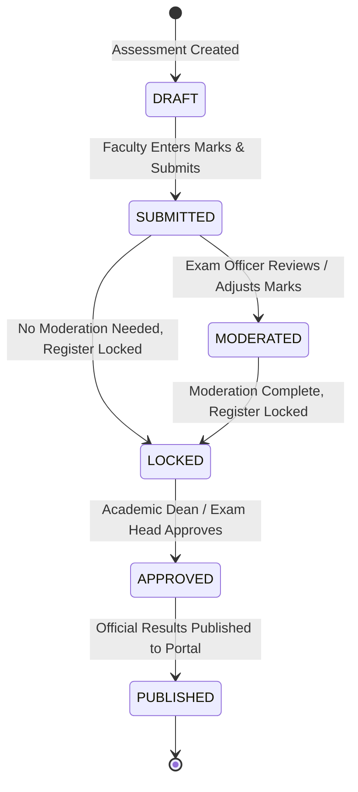

# Examinations and Results Workflow Specification

## 1. Actors and Roles
- **Examination Officer (`EXAM_OFFICER`):** Configures examination schedules, runs candidate eligibility evaluation snapshots, moderates marks, locks registers, compiles results, publishes official transcripts, and executes audited amendments.
- **Faculty (`FACULTY`):** Enters continuous internal assessment (CIA) and semester-end marks (SEE) in batch grid mode, and locks/submits marks registers.
- **Student (`STUDENT`):** Views exam timetable, hall-ticket eligibility status, and published results in the Student Portal.

---

## 2. Examination Setup and Eligibility Evaluation

### 2.1 Candidate Eligibility Snapshot (`examRegistrations`)
Prior to exam commencement and hall-ticket issuance, candidate eligibility is evaluated and frozen in the `examRegistrations` collection:
- `attendancePercentage`: Pulled from valid sessions in the offering.
- `feeCleared`: Verified against unpaid `feeObligations` for the student in that term.
- `condonationGranted`: Recorded if `COLLEGE_ADMIN` grants a condonation with an explicit reason for attendance between 65.00% and 74.99%.
- `hallTicketIssued`: Flagged `true` only when `isEligible == true`.

---

## 3. Marks Entry and Moderation State Machine

Marks follow an explicit linear state progression:

### 3.1 Separation of Raw vs. Moderated Marks
- **Faculty Entry (`DRAFT`):** Faculty enters marks using the batch tabular grid (`PUT /api/v1/assessments/{assessmentId}/marks/batch`). The system validates that each mark satisfies $0 \le \text{rawMarks} \le \text{maxMarks}$.
- **Submission (`SUBMITTED`):** Faculty locks the register. Faculty editing is disabled.
- **Moderation (`MODERATED`):**
  - If the Examination Committee applies moderation (e.g., standardizing marks or correcting an evaluation discrepancy), the original `rawMarks` is **never overwritten**.
  - The moderated mark is stored in `moderatedMarks`, accompanied by a mandatory `moderationReason`, `moderatedBy`, and `moderatedAt` timestamp.
- **Locking (`LOCKED`):** Exam Officer locks the assessment, preventing further mark edits.

---

## 4. Result Compilation and Publication

1. **Compilation:**
   - Once all assessments for a course offering (CIA + SEE) are in `LOCKED` status, the Examination Officer triggers result compilation.
   - For each student, the system calculates:
     - Component marks and total percentage: $\text{CIA (40%)} + \text{SEE (60%)}$.
     - Minimum pass criteria check: $\text{SEE} \ge 40.00\%$ and $\text{Combined} \ge 40.00\%$.
     - Grade conversion: 10-point UGC CBCS scale (O, A+, A, B+, B, C, P, F, Ab) and grade point.
   - Result records are saved in `results` with status `DRAFT_COMPILED`.
2. **Approval (`APPROVED`):** The Controller of Examinations or Dean reviews the compiled grade distribution and formally approves.
3. **Publication (`PUBLISHED`):**
   - The Exam Officer executes publication.
   - **Student Visibility Invariant:** Results become visible to students in the Student Portal **only** when `status == "PUBLISHED"`. Draft or approved marks are strictly hidden from students.
   - Publication is idempotent and repeat-safe.

---

## 5. Result Amendment Workflow

Published results are **immutable** and cannot be overwritten by normal update endpoints. If an error is proven (e.g., revaluation / re-totalling):
1. An Exam Officer submits an amendment request specifying `resultId`, `studentId`, `newMarks`, `newGrade`, and a mandatory `reason`.
2. The amendment requires approval from the College Administrator or Dean.
3. Upon approval:
   - A `resultAmendments` document is inserted: `{ resultId, studentId, priorMarks, newMarks, priorGrade, newGrade, reason, requestedBy, approvedBy, timestamp: UtcNow }`.
   - The `results` document is updated under optimistic concurrency (`version`), updating marks, grade, outcome, and recomputing SGPA/CGPA.
   - An immutable entry is appended to `auditEvents`.

---

## 6. Testing and Verification Requirements

- **Marks Range Validation:** Verify that entering marks $> \text{maxMarks}$ or negative numbers is rejected.
- **Raw Mark Preservation:** Perform moderation on a mark of 32 to 36; verify that `rawMarks` remains 32, `moderatedMarks` is 36, and `moderationReason` is recorded.
- **Student Visibility Isolation:** Attempt to fetch results via student portal endpoints while status is `DRAFT_COMPILED` or `APPROVED`; verify the API returns empty/404 until status is `PUBLISHED`.
- **Amendment Audit Integrity:** Execute a post-publication grade change from `F` to `P`; verify that `resultAmendments` captures prior and new values with actor IDs.
