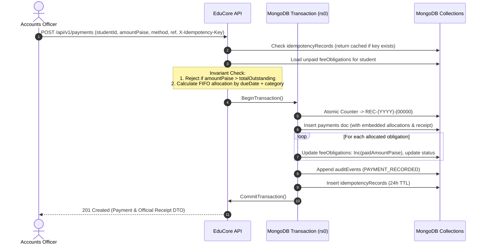

# Fees and Payments Workflow Specification

## 1. Actors and Roles
- **Accounts Officer (`ACCOUNTS_OFFICER`):** Configures fee structures, records manual fee payments, prints receipts, grants fee concessions, and executes payment reversals.
- **College Administrator (`COLLEGE_ADMIN`):** Approves fee structures, grants emergency financial clearance, and audits transactions.
- **Student (`STUDENT`):** Views personal fee obligations, payment histories, and downloads official receipts in the Student Portal.
- *(Online payment gateway integration is explicitly deferred to V2; all V1 payments are collected and recorded by staff).*

---

## 2. Main Path: Payment Collection and Receipt Issuance

### 2.1 Step-by-Step Execution
1. **Obligation Loading:** Accounts Officer selects a student. The API fetches all unpaid/partially paid `feeObligations` ordered by `dueDate` ascending.
2. **Amount Validation & Overpayment Block:**
   - The officer enters `amountPaise`, payment method (`CASH`, `CHEQUE`, `BANK_TRANSFER`, `POS`), and external reference.
   - **Overpayment Invariant:** If `amountPaise` exceeds the total remaining unpaid obligations for the student, the request is rejected immediately with HTTP `400 Bad Request` (`EXCESS_PAYMENT_NOT_PERMITTED`). Unallocated advance deposits are not supported in V1.
3. **Allocation Calculation:**
   - **Default FIFO:** Allocations distribute across obligations sorted by `dueDate` ascending. If multiple obligations share the exact same `dueDate`, funds allocate in priority tie-breaker order: `TUITION` -> `LAB` -> `LIBRARY` -> `EXAM` -> `MISC`.
   - **Manual Override:** Accounts Officer may specify custom allocation amounts per obligation. The server verifies that $\sum \text{Allocations} = \text{amountPaise}$ and requires a mandatory override justification.
4. **Transactional Persistence (Multi-Document ACID):**
   Within a MongoDB transaction (`IClientSession.StartTransaction()`):
   - Atomically generate sequential `receiptNumber` from `counters` (`REC-{YYYY}-{00000}`).
   - Insert `payments` document containing the payment amount, method, reference, idempotency key, embedded `receipt` metadata, and embedded `allocations: [{ obligationId, amountPaise, isVoid: false }]`.
   - Update each affected `feeObligations` document: increment `paidAmountPaise` by its allocated amount, and transition `status` to `PAID` (if `paidAmountPaise == amountPaise`) or `PARTIALLY_PAID`.
   - Append an immutable entry to `auditEvents`.
   - Record the operation in `idempotencyRecords` with a 24-hour TTL expiration.
5. **Receipt Issuance:** The API returns the completed payment record and receipt DTO. The frontend prompts to print the official receipt.

---

## 3. Audited Payment Reversal Workflow

If a cheque is dishonored or an entry was recorded in error:
1. **Reversal Invariant:** Recorded payments and receipts are **never deleted**.
2. **Transactional Reversal Execution:**
   Within a MongoDB transaction:
   - Verify that the target `payments` document has `status == "CONFIRMED"`.
   - Update `payments.status` to `"REVERSED"`, set `reversalMetadata: { reversedBy, reversedAt: UtcNow, reason, authorizedBy }`, and flag all embedded allocations as `isVoid = true`.
   - Update embedded `payments.receipt.status` to `"CANCELLED"`.
   - For each voided allocation, update the linked `feeObligations` document: decrement `paidAmountPaise` by the voided amount, and recompute status back to `PENDING` or `PARTIALLY_PAID`.
   - Append an immutable `PAYMENT_REVERSED` entry to `auditEvents`.
3. **Ledger Integrity:** The student's outstanding balance is automatically restored to reflect the unpaid obligation amounts.

---

## 4. Idempotency and Transaction Failure Handling

1. **Idempotency Header:** Mutating payment requests require an `X-Idempotency-Key` header (UUID).
   - If a network failure occurs after the server commits the transaction, a client retry carrying the same idempotency key detects the existing `idempotencyRecords` entry and immediately returns the cached `201 Created` receipt response without executing a second payment.
2. **Transient Transaction Failures:**
   - The infrastructure transaction execution strategy catches `MongoTransientTransactionException` (such as write conflicts) and automatically retries the transaction up to 3 times with exponential backoff.
3. **Non-Transient Failures:**
   - If an unrecoverable database or validation error occurs, the transaction is cleanly aborted (`session.AbortTransactionAsync()`). No partial allocations or orphaned receipts remain.

---

## 5. Testing and Verification Requirements

- **Exact Integer Paise Arithmetic:** Verify partial payments across 3 obligations; ensure sums and remaining balances match down to the exact paisa without rounding errors.
- **Overpayment Rejection:** Verify that paying ₹50,001 against a ₹50,000 obligation returns HTTP `400 Bad Request`.
- **Reversal Ledger Restitution:** Record a ₹20,000 payment against a ₹30,000 obligation (leaving ₹10,000 due). Execute a reversal; verify that the obligation reverts to ₹30,000 due (`PARTIALLY_PAID` -> `PENDING`), the payment status is `REVERSED`, and the receipt is `CANCELLED`.
- **Idempotency Replay Test:** Post the same payment request twice with identical `X-Idempotency-Key`; verify only one payment document is inserted and identical receipts are returned.
