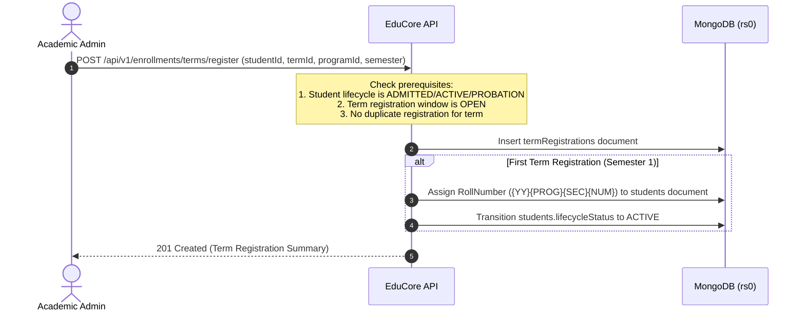

# Student and Academic Enrollment Workflow

## 1. Actors and Roles
- **Academic Administrator (`ACADEMIC_ADMIN`):** Manages term registration windows, sections, course offerings, and student enrollments.
- **College Administrator (`COLLEGE_ADMIN`):** Oversight, capacity overrides, and deadline extensions.
- **Student (`STUDENT`):** Views personal registered courses and section timetable in the Student Portal.

---

## 2. Term Registration Workflow



### 2.1 Step-by-Step Execution
1. **Prerequisite Check:**
   - The student must be in `ADMITTED` (for initial entry) or `ACTIVE` / `PROBATION` status.
   - Target `termId` must have an open registration window (`isOpen == true` and current UTC date within `startDate` and `endDate`).
   - The student must not already possess a `termRegistration` for that `termId` (enforced by a unique compound index on `{ studentId: 1, termId: 1 }`).
2. **Persistence and Roll Number Assignment:**
   - System creates a `termRegistrations` record: `{ studentId, termId, programId, semesterNumber, academicStanding: "REGULAR", status: "REGISTERED", registeredAt: UtcNow }`.
   - If this is the student's Semester 1 registration, the system assigns their official institutional `RollNumber` (e.g. `24BCA-A015`) and transitions `students.lifecycleStatus` from `ADMITTED` to `ACTIVE`.

---

## 3. Course Enrollment and Capacity Enforcement

### 3.1 Enrollment Invariants
- A student can only enroll in `courseOfferings` associated with their registered `termId`.
- Exactly one active enrollment per student per course offering (enforced by unique index on `{ studentId: 1, courseOfferingId: 1 }`).
- Prerequisites must be satisfied (verified against the student's historical completed courses with passing grades).

### 3.2 Atomic Section Capacity Enforcement
Course offering sections have strict physical room and lab capacity limits. To prevent oversubscription under concurrent enrollment requests:
```csharp
// 1. Atomically claim a seat in the course offering
var capacityFilter = Builders<CourseOffering>.Filter.And(
    Builders<CourseOffering>.Filter.Eq(x => x.Id, offeringId),
    Builders<CourseOffering>.Filter.Where(x => x.EnrolledCount < x.Capacity)
);
var incrementUpdate = Builders<CourseOffering>.Update.Inc(x => x.EnrolledCount, 1);
var claimResult = await _offeringsCollection.UpdateOneAsync(capacityFilter, incrementUpdate);

if (claimResult.ModifiedCount == 0)
{
    throw new CapacityExceededException($"Section {offering.Section} has reached its maximum capacity of {offering.Capacity}.");
}

// 2. Persist the enrollment record
try
{
    var enrollment = new CourseEnrollment
    {
        StudentId = studentId,
        CourseOfferingId = offeringId,
        TermId = termId,
        Status = "ENROLLED",
        EnrolledAt = DateTime.UtcNow
    };
    await _enrollmentsCollection.InsertOneAsync(enrollment);
}
catch
{
    // Compensate seat count if enrollment insert fails
    await _offeringsCollection.UpdateOneAsync(
        Builders<CourseOffering>.Filter.Eq(x => x.Id, offeringId),
        Builders<CourseOffering>.Update.Inc(x => x.EnrolledCount, -1)
    );
    throw;
}
```

### 3.3 Course Withdrawal
- A student may withdraw from a course offering during the permitted add/drop window.
- Course withdrawal is **never** a hard delete:
  - `courseEnrollments.status` transitions to `WITHDRAWN`.
  - `courseOfferings.enrolledCount` is atomically decremented by 1.
  - A withdrawal reason and UTC timestamp are recorded.

---

## 4. Testing and Verification Requirements

- **Concurrency Test:** Simulate 50 concurrent enrollment requests against a course offering with `capacity = 40`. Verify that exactly 40 enrollments succeed, 10 fail with HTTP `400 Bad Request` (`CAPACITY_EXCEEDED`), and `enrolledCount` finishes at exactly 40.
- **Duplicate Prevention Test:** Verify that attempting to register twice for the same term or course returns HTTP `409 Conflict`.
- **Prerequisite Enforcement Test:** Verify that attempting to enroll in *Data Structures* without passing *Programming in C* is blocked with an explicit prerequisite error.
